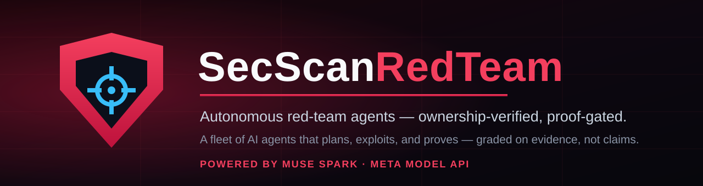

<p align="center">
  
</p>

<p align="center">
  English | <a href="README.zh.md">中文</a>
</p>

<p align="center">
  <a href="LICENSE"></a>
  <a href="https://github.com/cc4480/secscan-redteam-desktop/actions/workflows/windows-installer.yml"></a>
  
  =24">
  
</p>

**SecScan RedTeam** is a desktop application that runs autonomous red-team engagements against systems you own. You describe a target in chat; a fleet of five AI agents — a Lead coordinator, recon, exploiter, architect, and reporter, all seated on Muse Spark through the Meta Model API — plans the engagement, probes the target, exploits what it finds, and proves every claim before it is reported. The finished report renders in the same chat thread: an anchored letter grade, a severity breakdown, and findings ordered PROVEN → CONFIRMED → DEFERRED → RULED OUT, each with evidence and a paste-ready fix.

Two rules shape everything the product does:

- **Ownership before offense.** Active testing runs only against targets whose ownership is verified — for web targets, verification is server-authoritative through the SecScan service's verified-domain list, checked at the moment of dispatch, with no local allowlist and no bypass. Outside verified scope, the fleet sends zero packets.
- **Proof over claims.** A finding counts when it carries a receipt: a replayable proof bundle with a passing negative control for PROVEN, a second independent observation for CONFIRMED. Everything else is labeled DEFERRED or RULED OUT, never quietly upgraded.

## What it does

| Area | What ships in this tree | Documentation |
|---|---|---|
| Chat-first engagements | One page: chat launches the real engagement engine (`engagement_launch` / `engagement_status` / `engagement_report`), progress narrates in-thread, the report renders in-thread as designed HTML | [Architecture](docs/product/architecture.md) |
| The fleet | Five roles on a shared task board and durable mailbox; bounds of 100 members, depth 4, 25 helpers per member, 4,096 board tasks | [Architecture](docs/product/architecture.md#the-fleet) |
| Native check battery | The SecScan and Seclayer engines embedded in the runner: web, API, BaaS, cloud-storage, secrets-in-bundle, and framework probes, plus BOLA/IDOR two-account testing and the RED_TEAM module set | [Engines & coverage](docs/product/engines-and-coverage.md) |
| External engines | nmap, nuclei, ffuf, gobuster, sqlmap, nikto, and John the Ripper resolved through one toolchain, a Metasploit RPC integration, and a vendored tool payload in the desktop package | [Engines & coverage](docs/product/engines-and-coverage.md#external-engines) |
| Anchored grading | One scoring voice: Seclayer's anchored engine under the SecScan name — confirmed findings deduct in full, heuristics are damped and capped, one confirmed critical anchors the grade at F | [Engines & coverage](docs/product/engines-and-coverage.md#grading-one-voice) |
| Connected services | The SecScan MCP service (scans, domain verification, monitors) and the Seclayer MCP service (a second-opinion scanner) — each with your own key, stored in the app's encrypted credential store | [MCP services](docs/product/mcp-services.md) |
| Models | Muse Spark 1.3 on every fleet seat; Muse Wonder 1.0 for explicit small calls; a provider-resilience layer (classified failover, credential pool, cooldowns); a llama.cpp local-model manager | [Models](docs/product/models.md) |
| Foundry | Real engagements capture sanitized cases into an in-app store; candidate tests run the Gold Loop (propose → prove → challenge → score → adjudicate → decide) before joining the battery | [Overview](docs/product/overview.md#foundry-the-self-improving-loop) |
| Continuous watch | Watch profiles keep a baseline per target and report configuration drift between runs | [Engines & coverage](docs/product/engines-and-coverage.md#continuous-watch) |

## Quickstart

### Install the desktop app (Windows)

Download the installer from the project's GitHub Releases and run it. The installer is unsigned by design in CI builds; Windows will ask you to confirm. The app opens straight to chat — no account, no login wall.

On first run, the welcome flow asks for one required key and offers two optional ones:

1. **Meta Model API key** (required) — the fleet's models. Set it in the app, or provide `MODEL_API_KEY` in the environment.
2. **SecScan MCP token** (optional, recommended) — unlocks domain verification and the SecScan service's scans and monitors. Mint one at [secscan.us](https://secscan.us) → Settings → AI editors.
3. **Seclayer API key** (optional) — unlocks the Seclayer service as a second opinion. Create one in the Seclayer dashboard → Developer / API Keys.

Keys you enter are stored in the app's per-user credential store, encrypted with the operating system's keychain (Electron `safeStorage`); on Windows the store refuses plaintext by design. See [MCP services](docs/product/mcp-services.md) and [Configuration](docs/product/configuration.md).

### Run an engagement

Open the app and tell the chat what to test — for example, your own staging site or a local lab target such as a deliberately vulnerable training app on `127.0.0.1`. The Lead verifies authorization, narrates each phase (authorize → recon → exploit → report) in the thread, and delivers the graded HTML report in the same thread when the run completes.

### Build from source

Prerequisites: Node.js `^22.19.0 || >=24.0.0` and pnpm.

```sh
git clone https://github.com/cc4480/secscan-redteam-desktop.git
cd secscan-redteam-desktop
pnpm install
pnpm run build
pnpm run dev:desktop     # build, then launch the desktop app
```

`pnpm run start:desktop` launches without rebuilding. To produce the Windows installer locally: `pnpm run package:desktop:win:x64:unsigned`. The full pipeline — including the CI workflow that builds the published installer — is documented in [Build & install](docs/product/build-and-install.md).

## Documentation

Product documentation lives in [`docs/product/`](docs/product/README.md):

- [Overview](docs/product/overview.md) — what the product is, its surfaces, and its design principles.
- [Architecture](docs/product/architecture.md) — the fleet, the engagement lifecycle, and how the desktop app, harness, and runner fit together.
- [Security model](docs/product/security-model.md) — ownership verification, scope enforcement, the proof standard, and secrets handling.
- [Engines & coverage](docs/product/engines-and-coverage.md) — the native battery, external engines, grading, and the coverage model.
- [MCP services](docs/product/mcp-services.md) — the SecScan and Seclayer connections: what they unlock, where keys come from, how they are stored.
- [Models](docs/product/models.md) — Meta Model API seats, the resilience layer, and local models.
- [Configuration](docs/product/configuration.md) — environment variables, the credential store, fleet bounds, and profile overrides.
- [Build & install](docs/product/build-and-install.md) — building from source and the Windows installer pipeline.
- [Development guide](docs/product/development.md) — repository layout and the house rules for working in this tree.
- [FAQ & troubleshooting](docs/product/faq.md)

The underlying agent-harness platform keeps its own references in [`docs/`](docs/architecture.md) (architecture, subsystems, and the Cordis API); the product set links into them where they are authoritative.

## Security posture

SecScan RedTeam is an offensive tool for systems you own or are authorized to test. Its own safeguards are part of the product, not configuration advice: server-authoritative ownership verification before active scans, a scope gate on every tool dispatch, verification-gated test tiers, a target-distress circuit breaker, and proof-gated reporting. Read the [security model](docs/product/security-model.md) before running an engagement, and see [SECURITY.md](SECURITY.md) for reporting vulnerabilities in this project and [SAFETY.md](SAFETY.md) for the safety notice.

## Roadmap, stated plainly

The following agreed pieces are designed and in progress; they are **not** in this tree yet, and nothing in the documentation above claims them: the **Arsenal** knowledge server (`arsenal_search` / `arsenal_browse` / `arsenal_recommend` over an indexed corpus of public security collections), the full monitoring union (hourly CVE+EPSS matching, certificate-expiry alerts, grade-following rescans — the shipped continuous watch covers baselines and drift), L0/L1/L2 memory tiering over the runner's trajectory store, and registration of Muse Spark 1.2 / 1.1 in the model registry (the registry in this tree seats Spark 1.3 and Wonder 1.0).

## Provenance

SecScan RedTeam is built on an everything-is-a-plugin agent harness (Cordis-based) that originated in the DeepSeek Harness codebase; the product, its engines, its grading, and its brand are SecScan's. The brand is defined in [BRAND_GUIDELINES.md](BRAND_GUIDELINES.md).

## License

[MIT](LICENSE). Third-party dependencies and their licenses are disclosed in [THIRD_PARTY_NOTICES.md](THIRD_PARTY_NOTICES.md).
