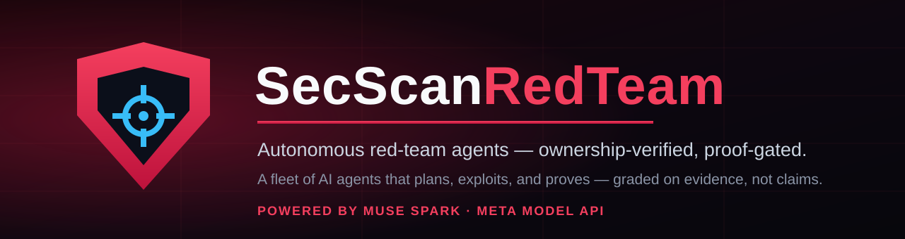

<p align="center">
  
</p>

<p align="center">
  <a href="README.md">English</a> | 中文
</p>

<p align="center">
  <a href="LICENSE"></a>
  <a href="https://github.com/cc4480/secscan-redteam-desktop/actions/workflows/windows-installer.yml"></a>
  
  =24">
  
</p>

**SecScan RedTeam** 是一款桌面应用，对您拥有的系统运行自主红队评估。您在聊天中描述一个目标；由五个 AI 智能体组成的舰队——Lead 协调者、侦察、利用、架构师与报告员，全部经 Meta Model API 运行于 Muse Spark——规划评估、探测目标、利用所发现的问题，并在报告之前证明每一项主张。最终报告在同一聊天线程中呈现：锚定字母评级、严重等级分布，以及按 PROVEN → CONFIRMED → DEFERRED → RULED OUT 排序的发现，每项都附带证据与一段可直接粘贴的修复提示。

两条规则塑造了本产品的一切行为：

- **先所有权，后进攻。** 主动测试仅针对所有权已验证的目标运行——对于 Web 目标，验证经 SecScan 服务的已验证域名列表以服务器为准，在派发的那一刻检查，没有本地允许名单，没有绕过。在已验证范围之外，舰队发送零个数据包。
- **以证明为准。** 一项发现只有在附带收据时才算数：PROVEN 需要可重放的证明包与通过的负控制；CONFIRMED 需要第二次独立观测。其余一律标记为 DEFERRED 或 RULED OUT，绝不悄悄升级。

## 功能

| 领域 | 本仓库中实际交付的内容 | 文档 |
|---|---|---|
| 聊天优先的评估 | 一页完成一切：聊天启动真正的评估引擎（`engagement_launch` / `engagement_status` / `engagement_report`），进度在线程中叙述，报告以设计的 HTML 在线程中呈现 | [架构](docs/product/architecture.md) |
| 舰队 | 五个角色共享一块任务板与持久邮箱；上限为 100 名成员、深度 4、每名成员 25 名助手、4,096 个看板任务 | [架构](docs/product/architecture.md#the-fleet) |
| 原生检查电池 | SecScan 与 Seclayer 引擎嵌入运行器：Web、API、BaaS、云存储、包内密钥与框架探测，外加 BOLA/IDOR 双账户测试与 RED_TEAM 模块集 | [引擎与覆盖](docs/product/engines-and-coverage.md) |
| 外部引擎 | nmap、nuclei、ffuf、gobuster、sqlmap、nikto 与 John the Ripper 经同一工具链解析，另有 Metasploit RPC 集成与桌面包内置的工具载荷 | [引擎与覆盖](docs/product/engines-and-coverage.md#external-engines) |
| 锚定评级 | 唯一评分声音：Seclayer 的锚定引擎以 SecScan 之名运行——已确认发现全额扣分，启发式发现被衰减并设上限，一个已确认的严重发现即把评级锚定为 F | [引擎与覆盖](docs/product/engines-and-coverage.md#grading-one-voice) |
| 已连接服务 | SecScan MCP 服务（扫描、域名验证、监控）与 Seclayer MCP 服务（第二意见扫描器）——各自使用您自己的密钥，存储于应用的加密凭据库 | [MCP 服务](docs/product/mcp-services.md) |
| 模型 | 每个舰队席位运行 Muse Spark 1.3；Muse Wonder 1.0 供显式的小型调用；一层提供商韧性层（分类故障转移、凭据池、冷却）；一个 llama.cpp 本地模型管理器 | [模型](docs/product/models.md) |
| Foundry | 真实评估将脱敏案例捕获至应用内存储；候选测试在加入电池之前先运行 Gold Loop（提出 → 证明 → 挑战 → 评分 → 裁决 → 决定） | [概览](docs/product/overview.md#foundry-the-self-improving-loop) |
| 持续观察 | 观察配置为每个目标保存一条基线，并报告运行之间的配置漂移 | [引擎与覆盖](docs/product/engines-and-coverage.md#continuous-watch) |

## 快速开始

### 安装桌面应用（Windows）

从本项目的 GitHub Releases 下载安装包并运行。CI 构建的安装包按设计未签名；Windows 会要求您确认。应用打开即直达聊天——没有账户，没有登录墙。

首次运行时，欢迎流程会要求一个必需密钥，并提供两个可选密钥：

1. **Meta Model API 密钥**（必需）——舰队的模型。在应用中设置，或在环境中提供 `MODEL_API_KEY`。
2. **SecScan MCP 令牌**（可选，推荐）——解锁域名验证以及 SecScan 服务的扫描与监控。在 [secscan.us](https://secscan.us) → Settings → AI editors 签发。
3. **Seclayer API 密钥**（可选）——将 Seclayer 服务解锁为第二意见。在 Seclayer 控制台 → Developer / API Keys 创建。

您输入的密钥存储于应用的每用户凭据库，以操作系统的密钥链加密（Electron `safeStorage`）；在 Windows 上，该存储按设计拒绝明文。参见 [MCP 服务](docs/product/mcp-services.md)与[配置](docs/product/configuration.md)。

### 运行一次评估

打开应用，告诉聊天要测试什么——例如您自己的预发布站点，或 `127.0.0.1` 上刻意留有漏洞的本地训练应用。Lead 验证授权，在线程中叙述每个阶段（authorize → recon → exploit → report），并在运行完成后在同一线程交付带评级的 HTML 报告。

### 从源码构建

前置要求：Node.js `^22.19.0 || >=24.0.0` 与 pnpm。

```sh
git clone https://github.com/cc4480/secscan-redteam-desktop.git
cd secscan-redteam-desktop
pnpm install
pnpm run build
pnpm run dev:desktop     # 构建，然后启动桌面应用
```

`pnpm run start:desktop` 跳过重新构建直接启动。在本地生成 Windows 安装包：`pnpm run package:desktop:win:x64:unsigned`。完整流水线——包括构建已发布安装包的 CI 工作流——记录于[构建与安装](docs/product/build-and-install.md)。

## 文档

产品文档位于 [`docs/product/`](docs/product/README.md)：

- [概览](docs/product/overview.md)——产品是什么、它的界面与设计原则。
- [架构](docs/product/architecture.md)——舰队、评估生命周期，以及桌面应用、框架与运行器如何组合。
- [安全模型](docs/product/security-model.md)——所有权验证、范围强制、证明标准与密钥处理。
- [引擎与覆盖](docs/product/engines-and-coverage.md)——原生电池、外部引擎、评级与覆盖模型。
- [MCP 服务](docs/product/mcp-services.md)——SecScan 与 Seclayer 连接：它们解锁什么、密钥从何而来、如何存储。
- [模型](docs/product/models.md)——Meta Model API 席位、韧性层与本地模型。
- [配置](docs/product/configuration.md)——环境变量、凭据库、舰队上限与配置覆写。
- [构建与安装](docs/product/build-and-install.md)——从源码构建与 Windows 安装包流水线。
- [开发指南](docs/product/development.md)——仓库布局与在本仓库中工作的规矩。
- [FAQ 与故障排查](docs/product/faq.md)

底层智能体框架平台在 [`docs/`](docs/architecture.md) 中保留其自身的参考文档（架构、子系统与 Cordis API）；产品文档集在这些文档具权威性之处链接至它们。

## 安全姿态

SecScan RedTeam 是针对您拥有或有权测试的系统的进攻性工具。它自身的安全机制是产品的一部分，而非配置建议：在主动扫描之前以服务器为准的所有权验证、每次工具派发上的范围门、需验证的测试层级、目标过载断路器，以及以证明为门的报告。在运行评估之前请阅读[安全模型](docs/product/security-model.md)；向本项目报告漏洞见 [SECURITY.md](SECURITY.md)，安全须知见 [SAFETY.md](SAFETY.md)。

## 路线图，坦率说明

以下已达成共识的部分已设计并在进行中；它们**尚未**进入本仓库，上述任何文档都不会声称它们存在：**Arsenal** 知识服务器（在已索引的公开安全集合语料上提供 `arsenal_search` / `arsenal_browse` / `arsenal_recommend`）、完整的监控组合（每小时 CVE+EPSS 匹配、证书到期提醒、跟随评级的深度复扫——已交付的持续观察覆盖基线与漂移）、在运行器轨迹存储之上的 L0/L1/L2 记忆分层，以及在模型注册表中注册 Muse Spark 1.2 / 1.1（本仓库的注册表配置的是 Spark 1.3 与 Wonder 1.0）。

## 出处

SecScan RedTeam 构建于一个源自 DeepSeek Harness 代码库的一切皆插件智能体框架（基于 Cordis）之上；产品本身、其引擎、其评级与其品牌属于 SecScan。品牌定义见 [BRAND_GUIDELINES.md](BRAND_GUIDELINES.md)。

## 许可证

[MIT](LICENSE)。第三方依赖及其许可证披露于 [THIRD_PARTY_NOTICES.md](THIRD_PARTY_NOTICES.md)。
